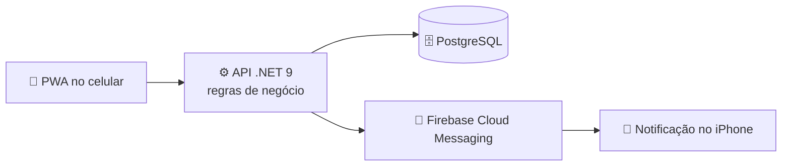

<div align="center">

# 📅 Agenda de Gravações e Edições para a Tomodachi

**Gravações, vídeos a editar e equipamentos em um só lugar, com avisos no iPhone até o item ser concluído.**


</div>

---

## 📌 Sobre o projeto

Projeto extensionista do **Bootcamp Análise de Sistemas e Banco de Dados** (UNISAGRADO, 2026/2). A regra do módulo é resolver uma necessidade **real** de uma organização real, então o trabalho é feito com a **Tomodachi**, produtora de filmagem de três pessoas. O fundador, Felipe Davi, pediu um calendário de gravações e edições, em aplicativo de celular, com notificações.

### O pedido

Na reunião de 31/10/2026, ficou combinado um calendário para a equipe registrar agendamentos e necessidades, com lembretes para evitar o esquecimento de equipamentos ou de qualquer outro item do dia. Por causa do prazo, a primeira versão cobre só o calendário (MVP), e o app é de celular.

### A solução

Um sistema que:

- 🎬 registra os **eventos de gravação**, com data, horário, local e os equipamentos usados;
- ✂️ registra os **vídeos a editar**, com prazo de edição, prazo de entrega e situação (a editar, em edição, entregue);
- 🚫 **bloqueia a reserva do mesmo equipamento em dois eventos ao mesmo tempo**;
- 📱 mostra a **agenda do dia e da semana** no celular;
- 🔔 envia **notificações push no iPhone** sobre gravações próximas e prazos de vídeo.

### Como funcionam as notificações

- Começam **48 horas antes** do prazo ou da gravação.
- Repetem a **cada 2 horas** até o item ser marcado como concluído ou confirmado no app.
- Gravações e prazos de entrega repetem. Avisos menores, como um equipamento reservado, são enviados uma vez só.
- Todos os aparelhos cadastrados recebem os avisos.

### Fora desta versão

- Chatbot no WhatsApp.
- Publicação na App Store ou na Play Store. O app funciona instalado direto na tela inicial do iPhone.
- Controle de pagamentos (o Felipe ofereceu a planilha dele, mas ficou de fora por enquanto).

---

## 🧭 Como funciona



---

## 🎨 Identidade visual

Tema escuro com destaque dourado (Champagne `#D6BD87`), fontes **Manrope** nos títulos e **Inter** nos textos, e uma cor para cada status.

<div align="center">


</div>

---

## 🗃️ Modelo de dados

O banco tem **7 tabelas** no PostgreSQL. O código-fonte do diagrama está em [`Readme Assets/02-der.mmd`](Readme%20Assets/02-der.mmd).

<div align="center">


</div>

| Tabela | O que guarda |
|---|---|
| `local` | Locais de gravação |
| `evento_gravacao` | Gravações, com horário e status (agendado, realizado, cancelado) |
| `equipamento` | Equipamentos disponíveis para reserva |
| `reserva_equipamento` | Equipamento em um evento (N:N), sem sobreposição de horário |
| `video` | Vídeos a editar, com prazos e status (a editar, em edição, entregue). O evento de origem é opcional |
| `notificacao` | Próximo envio, repetição e confirmação. Cada linha vem de um evento ou de um vídeo |
| `dispositivo` | Aparelhos que recebem as notificações (token do Firebase) |

### Regras garantidas pelo próprio banco

| Regra | Como o banco impõe |
|---|---|
| Um equipamento não pode estar em dois eventos ao mesmo tempo | `EXCLUDE USING gist (equipamento_id WITH =, periodo WITH &&)` |
| Cancelar um evento libera os equipamentos | Gatilhos que copiam o horário e a situação do evento para a reserva |
| O evento termina depois de começar | `CHECK (fim > inicio)` |
| Status só aceitam valores válidos | `CHECK` em `evento_gravacao` e `video` |
| A notificação tem uma origem: evento ou vídeo | `CHECK (num_nonnulls(evento_id, video_id) = 1)` |

### Banco funcionando

Tabelas criadas no PostgreSQL 17:

<div align="center">


</div>

Dados de exemplo, com a câmera reservada em horários diferentes:

<div align="center">


</div>

---

## 📁 Estrutura do repositório

| Pasta | Conteúdo |
|---|---|
| [`database/`](database/) | Scripts SQL: esquema, dados de exemplo e testes das regras |
| [`Readme Assets/`](Readme%20Assets/) | Imagens usadas neste README |
| [`Relatórios de Entrega/`](Relatórios%20de%20Entrega/) | Relatórios do bootcamp e prints da conversa com a Tomodachi |

As pastas `api/` e `pwa/` entram quando o desenvolvimento começar.

---

## 🚀 Como rodar o banco

Precisa do PostgreSQL 14 ou mais novo. Com o `psql`, a partir da raiz do repositório:

```bash
psql -U postgres -c "CREATE DATABASE tomodachi ENCODING 'UTF8'"
psql -U postgres -d tomodachi -v ON_ERROR_STOP=1 -f database/01-schema.sql
psql -U postgres -d tomodachi -v ON_ERROR_STOP=1 -f database/02-dados-exemplo.sql
```

O arquivo `database/03-testes-regras.sql` testa as regras, e cada teste indica o resultado esperado. Três deles falham de propósito.

---

## 👥 Equipe

| Integrante | Papel |
|---|---|
| Nickolas Passos Homem de Mello | Coordenação, banco de dados, API e regras de negócio |
| Rafaela Vilela China | Identidade visual |

Professor responsável: Victor Hugo Braguim Canto.

---

## 🗓️ Etapas

| Etapa | Prazo | Situação |
|---|---|---|
| Levantar a demanda e fechar o escopo com a Tomodachi | 31/10/2026 | ✅ Feito |
| Identidade visual | 14/11/2026 | ✅ Feito |
| Modelagem do banco (DER e scripts SQL) | 14/11/2026 | ✅ Feito |
| API em .NET 9, regras de negócio e PWA | 20/11/2026 | 🔜 A fazer |
| Notificações push, testes com a Tomodachi | 28/11/2026 | 🔜 A fazer |
| Relatório final | 03/12/2026 | 🔜 A fazer |
| Apresentação | 04 ou 05/12/2026 | 🔜 A confirmar |

Os prazos são de planejamento e podem mudar.
