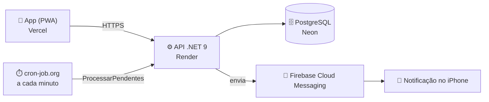

<div align="center">

# 📅 Agenda de Gravações e Edições para a Tomodachi

**Gravações, vídeos a editar e equipamentos em um só lugar, com avisos no iPhone até o item ser concluído.**


**App:** [tomodachi-web.vercel.app](https://tomodachi-web.vercel.app)

</div>

---

## 📌 Sobre o projeto

Projeto extensionista do **Bootcamp Análise de Sistemas e Banco de Dados** (UNISAGRADO, 2026/2). A regra do módulo é resolver uma necessidade **real** de uma organização real, então o trabalho é feito com a **Tomodachi**, produtora de filmagem de três pessoas, fundada por **Felipe Davi**. Ele pediu um calendário de gravações e edições, em aplicativo de celular, com notificações.

### O pedido

Na reunião de 31/10/2026 com o Felipe, ficou combinado um calendário para a equipe registrar agendamentos e necessidades, com lembretes para evitar o esquecimento de equipamentos ou de qualquer outro item do dia. Por causa do prazo, a primeira versão cobre só o calendário (MVP), e o app é de celular.

### A solução

Um sistema que:

- 🎬 registra os **eventos de gravação**, com data, horário, local e os equipamentos usados;
- ✂️ registra os **vídeos a editar**, com prazo de edição, prazo de entrega e situação (a editar, em edição, entregue);
- 🚫 **bloqueia a reserva do mesmo equipamento em dois eventos ao mesmo tempo**;
- 📱 mostra a **agenda do dia e da semana** no celular, em um app instalável (PWA);
- 🔔 envia **notificações push no iPhone** sobre gravações próximas e prazos de vídeo.

### Como funcionam as notificações

- Começam **48 horas antes** do prazo ou da gravação.
- Repetem a **cada 3 horas** até o item ser marcado como concluído ou confirmado no app.
- Gravações e prazos de entrega repetem. O prazo de edição e o aviso de equipamento reservado são enviados uma vez só.
- Todos os aparelhos cadastrados recebem os avisos.
- **Horário de silêncio:** a equipe define em **Ajustes** o período em que nenhum aviso sai (padrão: 22h às 7h, horário de Brasília). O que venceu nesse período chega quando ele termina, e a sequência de 3 em 3 horas segue a partir dali. A configuração vale para todos.

### Fora desta versão

- Chatbot no WhatsApp.
- Publicação na App Store ou na Play Store. O app funciona instalado direto na tela inicial do iPhone.
- Controle de pagamentos (o Felipe ofereceu a planilha dele, mas ficou de fora por enquanto).

---

## 🧭 Como funciona



O servidor gratuito dorme quando ninguém usa, então quem dispara os avisos é um agendador externo, que pergunta à API a cada minuto se existe algum aviso vencido.

---

## 🎨 Identidade visual

Criada pela Rafaela: tema escuro com destaque dourado (Champagne `#D6BD87`), fontes **Manrope** nos títulos e **Inter** nos textos, e uma cor para cada status. O app também tem uma versão clara, que acompanha a configuração do celular.

<div align="center">


</div>

---

## 🗃️ Modelo de dados

O banco tem **9 tabelas** no PostgreSQL. O código-fonte do diagrama está em [`Readme Assets/02-der.mmd`](Readme%20Assets/02-der.mmd).

<div align="center">


</div>

| Tabela | O que guarda |
|---|---|
| `local` | Locais de gravação |
| `cliente` | Empresas para as quais a Tomodachi grava: nome, cor e logo (imagem pequena guardada como texto) |
| `evento_gravacao` | Gravações, com horário, cliente (opcional) e status (agendado, realizado, cancelado). Dia inteiro é uma gravação da meia-noite à meia-noite |
| `equipamento` | Equipamentos disponíveis para reserva |
| `reserva_equipamento` | Equipamento em um evento (N:N), sem sobreposição de horário |
| `video` | Vídeos a editar, com prazos e status (a editar, em edição, entregue). O evento de origem é opcional |
| `notificacao` | Próximo envio, repetição e confirmação. Cada linha vem de um evento ou de um vídeo |
| `dispositivo` | Aparelhos que recebem as notificações (token do Firebase) |
| `configuracao_notificacao` | Linha única com o horário de silêncio dos avisos |

### Regras garantidas pelo próprio banco

| Regra | Como o banco impõe |
|---|---|
| Um equipamento não pode estar em dois eventos ao mesmo tempo | `EXCLUDE USING gist (equipamento_id WITH =, periodo WITH &&)` |
| Cancelar um evento libera os equipamentos | Gatilhos que copiam o horário e a situação do evento para a reserva |
| O evento termina depois de começar | `CHECK (fim > inicio)` |
| Status só aceitam valores válidos | `CHECK` em `evento_gravacao` e `video` |
| A notificação tem uma origem: evento ou vídeo | `CHECK (num_nonnulls(evento_id, video_id) = 1)` |

### Banco funcionando

Tabelas criadas no PostgreSQL 17 (a imagem é da primeira versão, com 7 das 9 tabelas):

<div align="center">


</div>

Dados de exemplo, com a câmera reservada em horários diferentes:

<div align="center">


</div>

---

## 🔌 API

API REST em **.NET 9**, em camadas, com **EF Core** mapeado nas tabelas criadas pelos scripts SQL (sem migrations). Em desenvolvimento, a documentação interativa fica em `/swagger`.

```
api/src/
  Tomodachi.Domain       entidades e constantes de status
  Tomodachi.Repository   DbContext, configurações do EF Core, repositórios e DTOs
  Tomodachi.Application  regras de negócio
  Tomodachi.Services     envio das notificações pelo Firebase
  Tomodachi.API          controllers e Program.cs
```

Fluxo entre as camadas: `API → Application → Repository → Domain`.

### Endpoints disponíveis

| Grupo | Endpoints |
|---|---|
| Local | `ListarLocais`, `ObterLocal/{id}`, `CriarLocal`, `AtualizarLocal/{id}`, `DeletarLocal/{id}` |
| Equipamento | `ListarEquipamentos`, `ObterEquipamento/{id}`, `CriarEquipamento`, `AtualizarEquipamento/{id}`, `DeletarEquipamento/{id}` |
| Cliente | `ListarClientes`, `ObterCliente/{id}`, `CriarCliente`, `AtualizarCliente/{id}`, `DeletarCliente/{id}` |
| Evento | `ListarEventos`, `ListarEventosDoDia`, `ListarEventosDaSemana`, `ListarEventosDoMes`, `ObterEvento/{id}`, `CriarEvento`, `AtualizarEvento/{id}`, `CancelarEvento/{id}`, `ConcluirEvento/{id}` |
| Reserva | `ReservarEquipamento`, `LiberarEquipamento` |
| Vídeo | `ListarVideos`, `ObterVideo/{id}`, `CriarVideo`, `AtualizarVideo/{id}`, `AlterarStatusVideo/{id}`, `DeletarVideo/{id}` |
| Aparelho | `RegistrarDispositivo`, `ListarDispositivos`, `RemoverDispositivo/{id}` |
| Notificação | `ListarAbertas`, `ConfirmarNotificacao/{id}`, `ProcessarPendentes` |
| Configuração | `ObterSilencio`, `AtualizarSilencio` |

<div align="center">


</div>

### Agenda do dia

`GET /Evento/ListarEventosDoDia?data=2026-11-20` devolve os eventos do dia, sem os cancelados, com os equipamentos de cada um. Os horários chegam em UTC (`Z`) e o app converte para o horário de Brasília.

<div align="center">


</div>

### Conflito de equipamento bloqueado

Tentar reservar a câmera num evento das 10:00 às 11:00, quando ela já está no evento das 09:00 às 12:00, é recusado pelo banco, e a API devolve uma mensagem clara:

<div align="center">


</div>

### Login da equipe

A equipe inteira usa **uma senha só**, guardada no servidor (`APP_PASSWORD`). `POST /Auth/Login` confere a senha e devolve um token JWT, válido por 30 dias, que o app envia em todas as chamadas.

- Todas as rotas exigem o token, exceto `/health`, o login e o disparo das notificações (que tem a própria chave, `X-Job-Key`).
- O login aceita no máximo 5 tentativas por minuto para cada endereço.
- O token é assinado com `JWT_SECRET`. Sair do app, ou o token vencer, pede a senha de novo.

### Notificações na API

- Ao criar um evento ou um vídeo, a API agenda os avisos: o primeiro sai **48 horas antes** do prazo ou da gravação.
- Gravações e prazos de entrega **repetem a cada 3 horas** até o item ser concluído. O prazo de edição e o aviso de equipamento reservado são enviados **uma vez só**.
- Os horários seguem o combinado (por exemplo 09:00, 12:00, 15:00), sem acumular atraso. Se o servidor ficar parado, a API pula para a próxima rodada que ainda está no futuro.
- No horário de silêncio (guardado na tabela `configuracao_notificacao` e editável pelo app) o `ProcessarPendentes` não envia nada: os avisos vencidos esperam e saem quando ele termina, sem mandar vários de uma vez (cada aviso sai uma vez e já agenda o próximo horário depois do silêncio).
- Concluir ou cancelar um evento, ou entregar um vídeo, encerra os avisos. Mudar um horário ou prazo reagenda o aviso.
- Um agendador externo chama `POST /Notificacao/ProcessarPendentes` a cada minuto, com a chave `X-Job-Key` definida no servidor (`JOB_KEY`). O envio é feito pelo Firebase Cloud Messaging.

<div align="center">


</div>

---

## 📱 App (PWA)

App em **React, TypeScript, Vite e Tailwind**, instalável na tela inicial do iPhone. Fica na pasta [`pwa/`](pwa/).

| Tela | O que faz |
|---|---|
| Entrar | Senha da equipe, pedida na primeira vez e depois de sair ou do token vencer |
| Início | Resumo da semana e próximas gravações |
| Calendário | Agenda do dia, da semana e do mês, com navegação entre as datas. Cada gravação aparece com a cor e a logo do cliente |
| Gravação | Detalhes de uma gravação, com reserva e liberação de equipamentos, concluir e cancelar |
| Nova gravação | Cadastro de uma gravação, com cliente (opcional), local e horário, ou "dia inteiro". Em seguida abre a gravação para reservar equipamentos |
| Vídeos | Lista por situação, com botões para iniciar a edição e marcar como entregue |
| Novo vídeo | Cadastro de um vídeo, com a gravação de origem (opcional) e os prazos de edição e entrega |
| Cadastros | Clientes (nome, cor e logo), equipamentos e locais: criar, editar e excluir (equipamentos podem ser desativados) |
| Ajustes | Estado da conexão, ativação das notificações, horário de silêncio, instalação no iPhone e sair da conta |

<div align="center">


</div>

### Notificação no iPhone

Testado em 15/11/2026: com o app instalado na tela inicial e fechado, o aviso chega na tela de bloqueio.

<div align="center">


</div>

### Instalar no iPhone

1. Abra [tomodachi-web.vercel.app](https://tomodachi-web.vercel.app) no **Safari**.
2. Toque em compartilhar e escolha **Adicionar à Tela de Início**.
3. Abra o app pelo ícone e, em **Ajustes**, toque em **Ativar notificações**.

No iPhone as notificações só funcionam com o app instalado e aberto pelo ícone (iOS 16.4 ou mais novo).

---

## ☁️ Publicação

| Peça | Serviço | Observação |
|---|---|---|
| Banco | **Neon** (PostgreSQL) | Criado com os scripts de `database/` |
| API | **Render** (Docker, plano gratuito) | Pasta `api`, variáveis no painel do serviço |
| App | **Vercel** | Pasta `pwa`, variáveis no painel do projeto |
| Avisos | **cron-job.org** | Chama `ProcessarPendentes` a cada minuto |
| Push | **Firebase Cloud Messaging** | Credencial guardada fora do repositório |

Nenhum segredo fica no repositório. Os valores ficam em arquivos `.env` (ignorados pelo Git) e nos painéis dos serviços. As variáveis da API são `CONNECTION_STRING`, `CORS_ORIGINS`, `JOB_KEY`, `APP_PASSWORD`, `JWT_SECRET`, `FIREBASE_CREDENTIALS_JSON` e `SWAGGER_ENABLED`. As do app começam com `VITE_`. Os modelos estão em `api/.env.example` e `pwa/.env.example`.

---

## 📁 Estrutura do repositório

| Pasta | Conteúdo |
|---|---|
| [`api/`](api/) | API em .NET 9, em camadas |
| [`pwa/`](pwa/) | App instalável para o celular |
| [`database/`](database/) | Scripts SQL: esquema, dados de exemplo, testes das regras e consultas da agenda |
| [`Readme Assets/`](Readme%20Assets/) | Imagens usadas neste README |
| [`Relatórios de Entrega/`](Relatórios%20de%20Entrega/) | Relatórios do bootcamp e prints da conversa com a Tomodachi |

---

## 🚀 Como rodar

### Banco

Precisa do PostgreSQL 14 ou mais novo. Com o `psql`, a partir da raiz do repositório:

```bash
psql -U postgres -c "CREATE DATABASE tomodachi ENCODING 'UTF8'"
psql -U postgres -d tomodachi -v ON_ERROR_STOP=1 -f database/01-schema.sql
psql -U postgres -d tomodachi -v ON_ERROR_STOP=1 -f database/02-dados-exemplo.sql
```

O arquivo `database/03-testes-regras.sql` testa as regras, e cada teste indica o resultado esperado. Três deles falham de propósito.

Quem já tinha o banco criado antes dessas funções roda também, nesta ordem, `database/05-configuracao-notificacao.sql` (horário de silêncio) e `database/06-clientes.sql` (clientes), que criam o que falta sem mexer nos dados (podem ser repetidos sem problema).

### API

Precisa do .NET 9 SDK. A configuração fica no arquivo `api/.env`, que não vai para o GitHub:

1. Copie `api/.env.example` para `api/.env`.
2. Troque os valores marcados com `TROQUE_AQUI` (senha do banco, `JOB_KEY`, `APP_PASSWORD` e `JWT_SECRET`). Para enviar notificações de verdade, aponte `FIREBASE_CREDENTIALS_PATH` para o arquivo de credencial do Firebase, guardado fora do repositório. Sem ele, o envio é só simulado no log.
3. Rode, a partir da pasta `api`:

```bash
dotnet run --project src/Tomodachi.API
```

4. Abra `http://localhost:5080/swagger`.

### App

Precisa do Node.js. A partir da pasta `pwa`:

1. Copie `.env.example` para `.env` e preencha com os dados do projeto no Firebase.
2. Rode:

```bash
npm install
npm run build
npm run preview
```

3. Abra `http://localhost:4173`. O service worker, que recebe as notificações, só funciona no app compilado. Com `npm run dev` dá para ajustar o visual, mas sem notificações.

---

## 👥 Equipe e cliente

| Integrante | Papel |
|---|---|
| Nickolas Passos Homem de Mello | Coordenação, banco de dados, API, app e regras de negócio |
| Rafaela Vilela China | Identidade visual |

**Cliente:** Tomodachi, com o fundador Felipe Davi.

**Professor responsável:** Victor Hugo Braguim Canto.

---

## 🗓️ Etapas

| Etapa | Prazo | Situação |
|---|---|---|
| Levantar a demanda e fechar o escopo com a Tomodachi | 31/10/2026 | ✅ Feito |
| Identidade visual | 14/11/2026 | ✅ Feito |
| Modelagem do banco (DER e scripts SQL) | 14/11/2026 | ✅ Feito |
| API em .NET 9 e regras de negócio | 20/11/2026 | ✅ Feito |
| App (PWA) | 20/11/2026 | ✅ Agenda, vídeos e nova gravação no ar |
| Notificações push no iPhone | 28/11/2026 | ✅ Testadas em 15/11/2026 |
| Login compartilhado | 28/11/2026 | ✅ Feito |
| Telas de cadastro (vídeo, equipamento, local e reserva) | 28/11/2026 | ✅ Feito |
| Horário de silêncio das notificações, configurável no app | 28/11/2026 | ✅ Feito |
| Clientes com cor e logo, dia inteiro e calendário mensal | 28/11/2026 | ✅ Feito |
| Limpar os dados de exemplo e cadastrar os dados reais da Tomodachi | 28/11/2026 | 🔜 Limpeza feita; falta cadastrar os dados reais |
| Testes com a Tomodachi | 28/11/2026 | 🔜 A fazer |
| Relatório final | 03/12/2026 | 🔜 A fazer |
| Apresentação | 04 ou 05/12/2026 | 🔜 A confirmar |

Os prazos são de planejamento e podem mudar.
